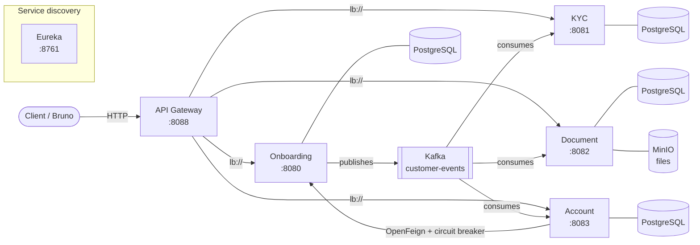
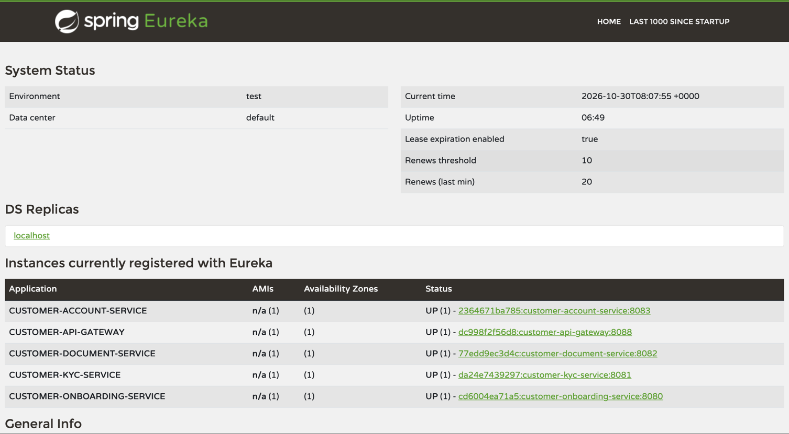
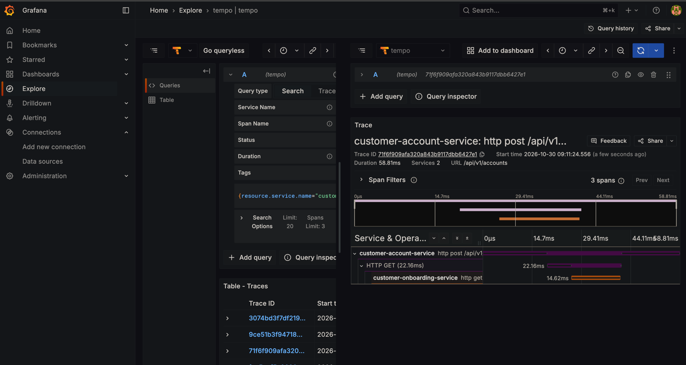
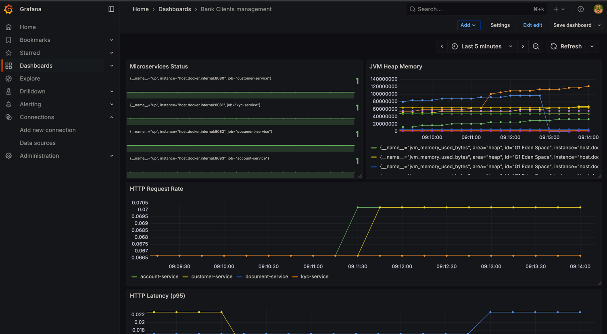

# Bank Clients Management

[](https://github.com/najidnizar/bank-clients-management/actions/workflows/ci.yml)


A microservices platform reproducing the core **customer lifecycle of a retail bank**: customer onboarding, KYC (Know Your Customer) compliance cases, identity document storage and bank account opening.

Built as a portfolio project to demonstrate a production-style backend architecture: service discovery, API gateway, database-per-service, event-driven communication with Kafka, resilience patterns, distributed tracing, containerization and CI.

---

## Architecture



| Service | Port | Responsibility |
|---|---|---|
| `service-discovery` | 8761 | Eureka server; every service registers here |
| `customer-api-gateway` | 8088 | Single entry point, routes by path to services resolved through Eureka |
| `customer-onboarding-service` | 8080 | Owns the **Customer** aggregate (create, update, search, block / unblock / close) and publishes customer events |
| `customer-kyc-service` | 8081 | Opens a **KYC case** automatically for every new customer and manages its review workflow |
| `customer-document-service` | 8082 | Uploads and downloads customer documents; metadata in PostgreSQL, files in MinIO |
| `customer-account-service` | 8083 | Opens and manages **bank accounts**, validating the customer synchronously with the onboarding service |

### Communication patterns

- **Synchronous REST through the gateway**: `/api/v1/customers/**`, `/api/v1/kyc-cases/**`, `/api/v1/documents/**`, `/api/v1/accounts/**`.
- **Synchronous service-to-service**: the account service calls the onboarding service with **OpenFeign**, protected by a **Resilience4j circuit breaker** (404 → `CustomerNotFoundException`, outage → fallback `CustomerServiceUnavailableException`).
- **Asynchronous events**: the onboarding service publishes `CUSTOMER_CREATED` and `CUSTOMER_STATUS_CHANGED` to the `customer-events` Kafka topic (keyed by customer id). Each consumer has its own consumer group; the KYC service creates and updates KYC cases from these events.

### Design decisions

- **Database per service**: each service owns its PostgreSQL schema, managed exclusively by **Flyway** migrations (`ddl-auto: validate`).
- **No shared library**: each consumer keeps its own copy of the event contract, so services stay independently deployable.
- **Explicit state machines**: customers, KYC cases and accounts each have a status lifecycle with validated transitions; customer and account changes are recorded in status-history tables.
- **Layered architecture** (controller → service → repository) and a monorepo — see the [Architecture Decision Records](docs/adr).

---

## Tech stack

| Area | Technologies |
|---|---|
| Language & framework | Java 25, Spring Boot 4.1, Spring Cloud (Gateway, Netflix Eureka, OpenFeign) |
| Persistence | PostgreSQL 17, Spring Data JPA (Specifications for search), Flyway |
| Messaging | Apache Kafka 4 (KRaft) |
| Object storage | MinIO |
| Resilience | Resilience4j circuit breaker |
| Observability | Micrometer, Prometheus, OpenTelemetry tracing → Grafana Tempo, Grafana |
| Mapping & tooling | MapStruct, Lombok, Bean Validation, springdoc OpenAPI (Swagger UI) |
| Testing | JUnit 5, Mockito, `@WebMvcTest`, Testcontainers (PostgreSQL) |
| Delivery | Docker (multi-stage images), Docker Compose, GitHub Actions |

---

## Getting started

**Prerequisites:** Docker (with Docker Compose). Java 25 is only needed to run services outside Docker.

### Run everything in Docker

```bash
cd infrastructure/docker
docker compose --profile apps up -d --build
```

The first build takes a few minutes (Maven downloads dependencies); later builds are cached.

### Run only the infrastructure (services from your IDE)

```bash
cd infrastructure/docker
docker compose up -d
```

Then start each service with the `local` profile, Eureka first:

```bash
cd services/service-discovery && ./mvnw spring-boot:run
cd services/customer-onboarding-service && ./mvnw spring-boot:run -Dspring-boot.run.profiles=local
```

### Useful URLs

| Tool | URL |
|---|---|
| API Gateway | http://localhost:8088 |
| Eureka dashboard | http://localhost:8761 |
| Swagger UI (onboarding, same path on 8081–8083) | http://localhost:8080/swagger-ui/index.html |
| Grafana | http://localhost:3000 |
| Prometheus | http://localhost:9090 |
| MinIO console | http://localhost:9001 |

Ready-made API requests are available in the [Bruno](https://www.usebruno.com/) collection under [`bruno/`](bruno/bank-clients-management).

### Try it

```bash
# Create a customer through the gateway — a KYC case is then created automatically via Kafka
curl -X POST http://localhost:8088/api/v1/customers \
  -H "Content-Type: application/json" \
  -d '{
        "firstName": "Jane",
        "lastName": "Doe",
        "dateOfBirth": "1990-05-14",
        "email": "jane.doe@example.com",
        "phoneNumber": "+352 621 000 000"
      }'
```

The response contains the customer `id` and its business number (`C000000001`). A few seconds later the KYC service has opened a case for this customer (`NOT_STARTED`); event handling is idempotent, so a redelivered event never creates a duplicate case. The HTTP request is visible as a trace in Tempo.

---

## Observability

- **Metrics**: every service exposes `/actuator/prometheus`; Prometheus scrapes them (see [`prometheus.yml`](infrastructure/docker/prometheus/prometheus.yml)).
- **Tracing**: services export traces over OTLP to Grafana Tempo (100 % sampling in local). In Grafana: *Explore → Tempo → Search → Service Name*.

<!-- Screenshots: add images to docs/images/ and uncomment



-->

---

## Testing

```bash
cd services/<service-name>
./mvnw verify
```

Repository and context tests run against a real PostgreSQL started by **Testcontainers** (Docker required). The CI pipeline builds and tests every service in parallel, then checks that each Docker image builds.

---

## Project structure

```
├── services/                 # One independent Maven project per microservice
├── infrastructure/docker/    # Docker Compose, Prometheus and Tempo configuration
├── docs/                     # ADRs, architecture overview, domain model, diagrams
├── bruno/                    # API request collection
└── .github/workflows/        # CI pipeline
```

---

## Roadmap

- [x] Microservices, gateway and service discovery
- [x] Event-driven communication with Kafka
- [x] Circuit breaker on synchronous calls
- [x] Metrics and distributed tracing
- [x] Docker images, Docker Compose and CI
- [ ] Security: Keycloak, OAuth2 / JWT, role-based access
- [ ] Frontend application (Angular)
- [ ] Trace propagation across Kafka and provisioned Grafana dashboards
- [ ] Document and account services reacting to customer events
- [ ] Kubernetes deployment (Helm)

---

## License

[MIT](LICENSE) © Nizar Najid
