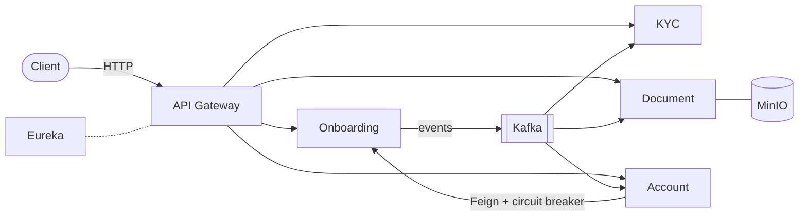
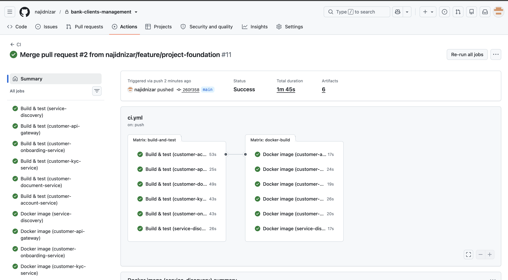

# Bank Clients Management

[](https://github.com/najidnizar/bank-clients-management/actions/workflows/ci.yml)


Microservices platform for the **customer lifecycle of a retail bank**: onboarding, KYC compliance, document storage and account opening.

### Highlights

- **6 Spring Boot 4 microservices** (Java 25) behind an **API Gateway**, with **Eureka** service discovery
- **Event-driven** with **Kafka**: a new customer automatically opens a KYC case (idempotent consumer)
- **Resilient** synchronous calls: OpenFeign + **Resilience4j circuit breaker**
- **Database per service**: PostgreSQL + Flyway migrations
- **Observability**: distributed tracing (**OpenTelemetry → Tempo**), metrics (**Prometheus**), **Grafana** dashboard
- **Docker** multi-stage images, one-command startup, **GitHub Actions CI**, **Testcontainers** tests

## Architecture



Each service owns its PostgreSQL database. All services register in Eureka. Design choices are documented as [ADRs](docs/adr) and the business rules in the [domain model](docs/domain-model.md).

**One request, one trace across services** — opening an account calls the onboarding service to validate the customer:


## Quick start

```bash
cd infrastructure/docker
docker compose --profile apps up -d --build
```

Then open the gateway on http://localhost:8088, Eureka on http://localhost:8761 and Grafana on http://localhost:3000.

## Tech stack

| Area | Technologies |
|---|---|
| Backend | Java 25, Spring Boot 4.1, Spring Cloud (Gateway, Eureka, OpenFeign), Spring Data JPA |
| Data & messaging | PostgreSQL 17, Flyway, Apache Kafka 4, MinIO |
| Resilience & observability | Resilience4j, Micrometer, OpenTelemetry, Prometheus, Grafana, Tempo |
| Quality & delivery | JUnit 5, Mockito, Testcontainers, Docker, Docker Compose, GitHub Actions |

## Roadmap

- [x] Microservices, gateway, service discovery
- [x] Kafka events and circuit breaker
- [x] Metrics and distributed tracing
- [x] Docker and CI
- [ ] Security: Keycloak, OAuth2 / JWT
- [ ] Frontend (React and / or Angular)
- [ ] Kubernetes deployment (Helm)

Known issues and technical debt are tracked in [docs/known-issues.md](docs/known-issues.md).

---

<details>
<summary><b>Services and API</b></summary>

| Service | Port | Responsibility |
|---|---|---|
| `service-discovery` | 8761 | Eureka server |
| `customer-api-gateway` | 8088 | Single entry point, routes `/api/v1/customers`, `/kyc-cases`, `/documents`, `/accounts` |
| `customer-onboarding-service` | 8080 | Customer aggregate (create, search, block / unblock / close); publishes `CUSTOMER_CREATED` and `CUSTOMER_STATUS_CHANGED` |
| `customer-kyc-service` | 8081 | Opens and manages KYC cases from customer events |
| `customer-document-service` | 8082 | Document upload / download; metadata in PostgreSQL, files in MinIO |
| `customer-account-service` | 8083 | Bank accounts; validates the customer via Feign with a circuit breaker |

Each service exposes Swagger UI at `http://localhost:<port>/swagger-ui/index.html`. Ready-made requests are in the [Bruno collection](bruno/bank-clients-management).

</details>

<details>
<summary><b>Design decisions</b></summary>

- **Database per service**, schemas managed only by Flyway (`ddl-auto: validate`).
- **No shared library**: each consumer keeps its own copy of the event contract, so services deploy independently.
- **Kafka topic keyed by customer id** to keep events of one customer in order; one consumer group per service.
- **Explicit state machines** for customers, KYC cases and accounts, with status-history tables.
- **Layered architecture and monorepo**.

Full reasoning, trade-offs and rejected alternatives are in the Architecture Decision Records:
[ADR-001 Monorepo](docs/adr/ADR-001-monorepo.md) ·
[ADR-002 Layered architecture](docs/adr/ADR-002-layered-architecture.md) ·
[ADR-003 Kafka events](docs/adr/ADR-003-event-driven-communication-with-kafka.md) ·
[ADR-004 Circuit breaker](docs/adr/ADR-004-synchronous-calls-and-circuit-breaker.md)

Aggregates, state machines and business rules: [Domain model](docs/domain-model.md).

</details>

<details>
<summary><b>Try it</b></summary>

```bash
curl -X POST http://localhost:8088/api/v1/customers \
  -H "Content-Type: application/json" \
  -d '{
        "firstName": "Jane",
        "lastName": "Doe",
        "dateOfBirth": "1990-05-14",
        "email": "jane.doe@example.com",
        "phoneNumber": "+352 621 000 000"
      }'
```

The response contains the customer `id` and business number (`C000000001`). The KYC service then opens a `NOT_STARTED` case for this customer via Kafka.

</details>

<details>
<summary><b>Run services from the IDE</b></summary>

Start only the infrastructure, then each service with the `local` profile (Eureka first):

```bash
cd infrastructure/docker && docker compose up -d
cd services/customer-onboarding-service && ./mvnw spring-boot:run -Dspring-boot.run.profiles=local
```

Tests: `./mvnw verify` in a service directory (Docker required for Testcontainers).

</details>

<details>
<summary><b>More screenshots</b></summary>

**Grafana dashboard** — availability, JVM heap, request rate and p95 latency per service.


**Eureka** — all services registered, running in Docker.


**CI pipeline** — every service is built and tested in parallel, then each Docker image is built.



</details>

---

[MIT](LICENSE) © Nizar Najid
