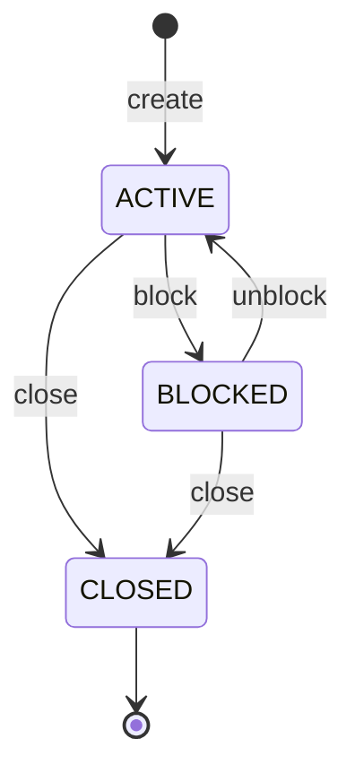
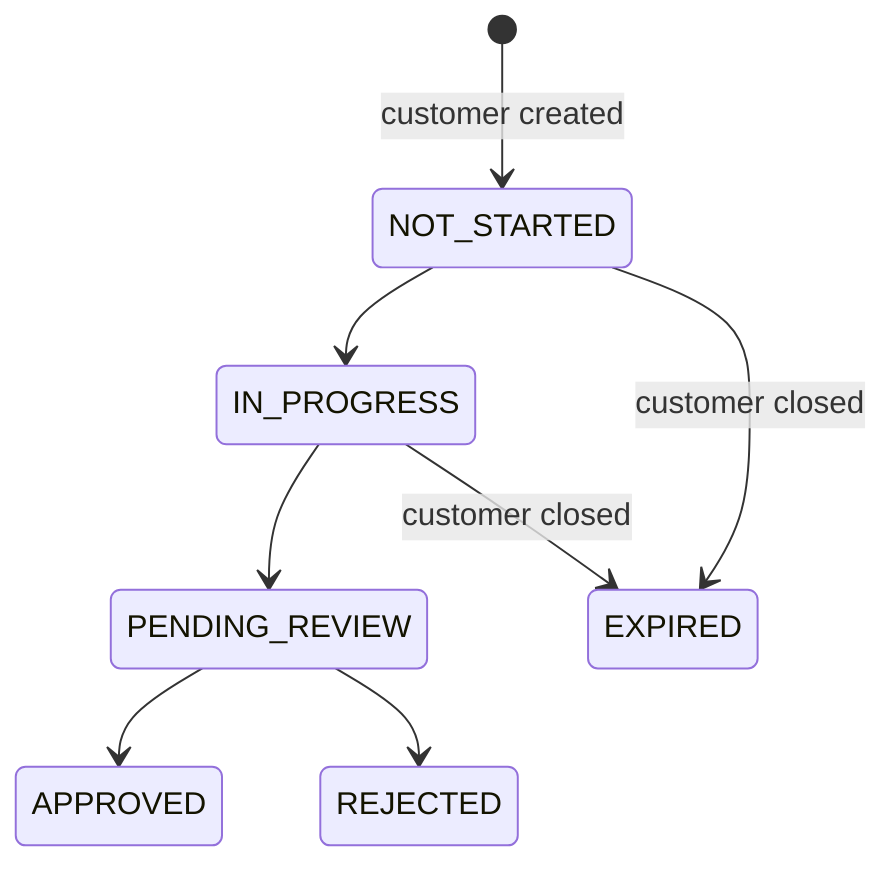
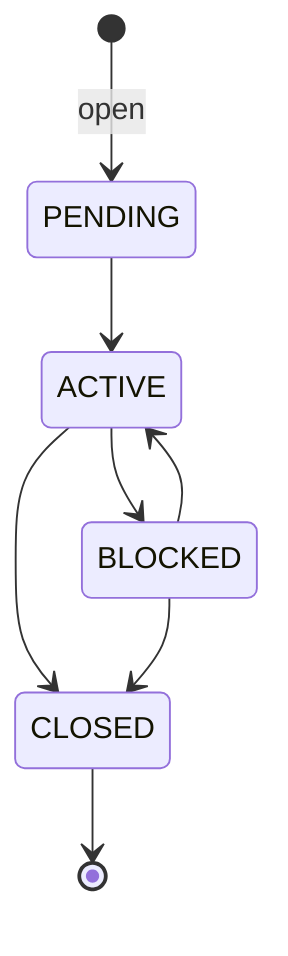

# Domain Model

The platform manages four aggregates, each owned by one service. Every aggregate has an explicit **state machine**: transitions are validated in the service layer and invalid ones are rejected with a dedicated exception.

| Aggregate | Owner service | Identifiers |
|---|---|---|
| Customer | onboarding | `id` (UUID, technical) + `customerNumber` (`C000000001`, business) |
| KYC case | kyc | `id` (UUID); exactly one case per customer |
| Bank account | account | `id` (UUID) + `accountNumber` (`ACC-…`) |
| Document | document | `id` (UUID); file stored in MinIO under `customerId/uuid` |

---

## Customer

The central aggregate. Every other service references customers by their UUID only.

**Rules**
- The email address is unique.
- `CLOSED` is final: no transition is allowed out of it.
- Every status change is recorded in `customer_status_history` (old / new status, author, reason) and published as a `CUSTOMER_STATUS_CHANGED` event.
- Optimistic locking (`version`) prevents lost updates; `createdBy` / `updatedBy` are filled by JPA auditing.

**Customer number** — a business identifier generated from a PostgreSQL sequence and formatted as `C` + 9 digits. It is human-readable and easy to communicate by phone, and independent from the technical UUID, which is never exposed as a business reference.

---

## KYC case

Opened automatically when a customer is created (`CUSTOMER_CREATED` event), with status `NOT_STARTED`, risk level `LOW` and score `0`.

**Rules**
- One case per customer: event handling is **idempotent**, a redelivered `CUSTOMER_CREATED` returns the existing case instead of creating a duplicate.
- When the customer is **closed**, an unfinished case (`NOT_STARTED`, `IN_PROGRESS`) is expired. A case under review or already decided is kept for audit.
- When the customer is **blocked**, the case is left unchanged.
- `APPROVED`, `REJECTED` and `EXPIRED` are final.

---

## Bank account

Opened on request, only for an existing customer: the account service checks the customer synchronously with the onboarding service (see [ADR-004](adr/ADR-004-synchronous-calls-and-circuit-breaker.md)).

**Rules**
- A new account starts `PENDING` with a zero balance in the requested currency.
- `CLOSED` is final.
- Every status change, including creation, is recorded in `account_status_history`.
- Optimistic locking (`version`).

---

## Document

Identity documents uploaded for a customer. Metadata (type, file name, content type, size, status) is stored in PostgreSQL; the file itself is stored in MinIO.

**Rules**
- A document is created with status `UPLOADED`.
- Downloads go through a **pre-signed MinIO URL valid for 15 minutes**: the service never streams files itself and the storage is never exposed directly.
- The review workflow (`VALIDATED`, `REJECTED`, `EXPIRED`) is defined but not implemented yet.
