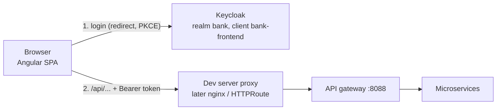

# Frontend architecture

> **Status**: in progress (branch `feature/frontend`). Done: Keycloak login, application shell, French / English. Next: customer list and search, customer creation, customer detail, accounts, KYC work queue, documents. Full plan and decisions: see the [roadmap](#roadmap) below.

A single-page application (SPA) for bank staff: advisors register customers, compliance officers review KYC cases, admins block or close customers and accounts. It calls the microservices through the API gateway.

## Stack

| Concern | Choice | Why |
|---|---|---|
| Framework | **Angular 22** (standalone components, signals, zoneless change detection, built-in control flow) | Widely used for enterprise / banking back-office applications; complete framework (routing, HTTP, forms, DI, testing) |
| Language | **TypeScript** (strict mode) | Imposed by Angular; type errors caught at compile time |
| UI components | **Angular Material** (Material 3 theme) | Official component library, accessible |
| Authentication | **keycloak-angular** + **keycloak-js** | OpenID Connect authorization code flow with **PKCE** against the existing Keycloak realm |
| Translations | **ngx-translate** | French / English, switched at runtime without reloading |
| State management | **NgRx Store** (planned, customers domain) | The state library most used in enterprise Angular code bases |
| API client | **Generated from the OpenAPI** contracts of the services (planned, `openapi-generator`) | Contract-first: the back-end contract is the single source of truth |
| Unit tests | **Vitest** + Angular `TestBed` | Default test runner since Angular 21 |
| End-to-end tests | **Playwright** (planned), run in CI against Docker Compose | |
| Tooling | Angular CLI, npm, Prettier | |

## Runtime architecture



- **Login**: the application starts with `login-required`: the user is redirected to Keycloak, then comes back with an authorization code that keycloak-js exchanges (with the PKCE verifier) for tokens. The password is never seen by the application; tokens are kept **in memory**.
- **API calls**: an HTTP interceptor adds `Authorization: Bearer <token>` **only to `/api/...` requests**, and refreshes the token first if it is about to expire.
- **Same origin, no CORS**: the browser only talks to the origin that served the application. In development, `ng serve` proxies `/api` to the gateway (`proxy.conf.json`); in a container, nginx will do the same; on Kubernetes, an HTTPRoute.
- **Inactivity**: after 15 minutes without user activity, the user is logged out (banking requirement).
- **Authorization**: the UI hides what the user's roles do not allow (`ADVISOR`, `COMPLIANCE_OFFICER`, `ADMIN`), for convenience only. **The back-end enforces the rules** (`@PreAuthorize`, tested with 401 / 403).

## Code organization

```
frontend/
├── public/i18n/            translations (en.json, fr.json), served as static files
├── proxy.conf.json         dev server: /api -> http://localhost:8088 (gateway)
└── src/
    ├── main.ts             entry point: bootstrapApplication(App, appConfig)
    ├── environments/       build-time configuration (Keycloak URL per environment)
    ├── testing/            test helpers (translations without HTTP)
    └── app/
        ├── app.config.ts   application-wide providers (Keycloak, HTTP, router, translations...)
        ├── app.routes.ts   routes, each screen lazy loaded
        ├── app.ts|html     shell: top bar (user, roles, language, logout) + router outlet
        ├── core/           cross-cutting services, used everywhere
        │   ├── auth/       AuthService (user, roles, logout), Role type
        │   └── i18n/       LanguageService, translated page title
        └── features/       one folder per business area, lazy loaded
            └── home/       home page
```

Rules:
- **One application, split by feature** (a "modular monolith" on the front-end). Micro-frontends are useful when several teams deliver independently; with one team they only add cost.
- **`core/`** holds singletons (`providedIn: 'root'`); **`features/<area>/`** holds the screens of one business area, loaded on demand.
- Components never use keycloak-js directly: they go through **`AuthService`** (easy to fake in tests, library replaceable).

## Key decisions

| Decision | Alternative | Reason |
|---|---|---|
| Authorization code + PKCE, tokens in memory | Password grant; tokens in `localStorage` | The password grant is removed from OAuth 2.1; `localStorage` is readable by any script (XSS). A BFF (tokens kept server-side) would be the next step for a real bank. |
| `login-required` | `check-sso` with public pages | Internal tool: nothing is visible without login |
| Token only on `/api/...` | Token on every request | Never leak a token to another domain |
| Same-origin proxy | CORS configuration in the gateway | Simpler and safer; nothing to configure in the back-end |
| `environment.ts` (build-time) | `config.json` loaded at startup | Standard Angular practice; limit: one image per environment |
| ngx-translate (runtime) | `@angular/localize` (compile-time, one build per language) | Language switch without reload |
| `checkLoginIframe: false` | Session iframe | Relies on third-party cookies, blocked by modern browsers |

## Running and testing

From `frontend/`, with the back-end running in Docker Compose (profile `apps`):

```bash
npm install     # dependencies
ng serve        # http://localhost:4200 (users: advisor / compliance / admin, password = username)
ng test         # unit tests (Vitest)
ng build        # production build into dist/
```

## Roadmap

1. ✅ Keycloak login, shell, role-aware home page
2. ✅ French / English
3. Demo data script
4. Customer list and search (NgRx, generated API client, server-side pagination, filters in the URL)
5. Customer creation (typed reactive forms, ProblemDetail errors, guards)
6. Customer detail (concurrent update handling, admin actions)
7. Accounts, KYC work queue, documents (with small back-end additions)
8. Quality: global error handling, accessibility, ESLint, Playwright in CI, Docker image (nginx)
