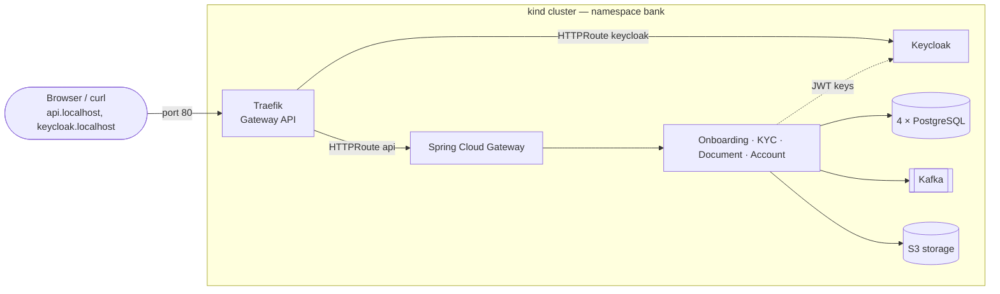

# Kubernetes

The whole platform runs on a local Kubernetes cluster ([kind](https://kind.sigs.k8s.io/)): infrastructure, microservices and an HTTP entry point. Files are in [`infrastructure/kubernetes/`](../infrastructure/kubernetes).

## Run it

Requirements: Docker (give it at least 12 GB of memory), `brew install kind kubectl helm`. Stop the Docker Compose stack first: both would run the whole platform.

```bash
./infrastructure/kubernetes/cluster-up.sh        # cluster + infrastructure + HTTP entry point
./infrastructure/kubernetes/deploy-services.sh   # the 6 microservices (images from GitHub Container Registry)

TOKEN=$(KEYCLOAK_URL=http://keycloak.localhost ./scripts/get-token.sh advisor)
curl -H "Authorization: Bearer $TOKEN" http://api.localhost/api/v1/customers
```

Keycloak admin console: http://keycloak.localhost (`admin` / `admin`). Pause the cluster with `docker stop bank-control-plane`, resume with `docker start bank-control-plane`, delete it with `kind delete cluster --name bank`.

## Architecture



| Layer | How it is deployed | Why |
|---|---|---|
| PostgreSQL ×4, Kafka, S3 storage | **StatefulSet** + headless **Service** + one **PersistentVolumeClaim** per pod (Kustomize, `infra/`) | Stateful: stable identity and their own disk, kept when the pod is recreated |
| Keycloak | **Deployment** + Service; realm imported from a **ConfigMap** built from the same JSON file as Docker Compose | Stateless in development mode |
| Microservices ×6 | One generic **Helm chart** (`helm/bank-service`), one release per service with its own values file (`helm/values/`) | Same shape for every service: one template, values per service |
| HTTP entry point | **Gateway API** (`gateway/gateway.yaml`: Gateway + HTTPRoutes) implemented by **Traefik** (Helm) | The standard replacement of Ingress (the community Ingress NGINX controller was retired in March 2026); Traefik is also the default entry point of k3s, used for cloud hosting |

## Design choices

- **Images** are pulled from GitHub Container Registry (`ghcr.io/najidnizar/bank-clients-management/<service>`), published by the CI from `main` for amd64 and arm64. The local cluster uses `latest`; a real environment deploys an immutable `sha-<commit>` tag.
- **Configuration** comes from environment variables (database, Kafka, Eureka, Keycloak addresses); **passwords** come from Secrets (`secretKeyRef`). The Secrets in Git hold demo credentials only — Kubernetes Secrets are Base64-encoded, not encrypted.
- **Probes** on the Spring Boot actuator: *startup* (up to 3 minutes, Spring Boot starts slowly), *liveness* (restart if stuck), *readiness* (removed from the Service while not ready). No external dependency in the liveness probe.
- **Resources**: 512 Mi requested, 768 Mi limit per service; the JVM sizes its heap from the limit (`-XX:MaxRAMPercentage=75`). No CPU limit, which would throttle the JVM.
- **Token issuer**: Keycloak's public URL is `http://keycloak.localhost` (tokens carry this issuer); services download the signing keys inside the cluster from `http://keycloak:8080`.
- **Eureka and Spring Cloud Gateway** are kept although Kubernetes provides discovery and routing: see [ADR-006](adr/ADR-006-service-discovery-and-gateway-on-kubernetes.md).

## Troubleshooting

| Symptom | Meaning | Command |
|---|---|---|
| `ImagePullBackOff` | Image not found or not accessible (name, tag, private package) | `kubectl describe pod <pod> -n bank` |
| `CrashLoopBackOff` | The container starts then crashes | `kubectl logs <pod> -n bank --previous` |
| `0/1` READY | Readiness probe failing (dependency not ready, slow start) | `kubectl describe pod <pod> -n bank` |
| Several pods restart together, `kubectl` times out | The node lacks memory or CPU | `docker stats`, Docker Desktop resources |
| StatefulSet pod not updated after a change | A broken pod blocks the ordered rollout | `kubectl delete pod <pod> -n bank` |

## Not production-ready (by design)

Single node, one replica of each component, Keycloak in development mode, HTTP only, demo credentials in Git, observability stack not deployed in the cluster (traces are not sampled). Cloud hosting (k3s, HTTPS, real secrets) is a later step of the [roadmap](../README.md#roadmap).
