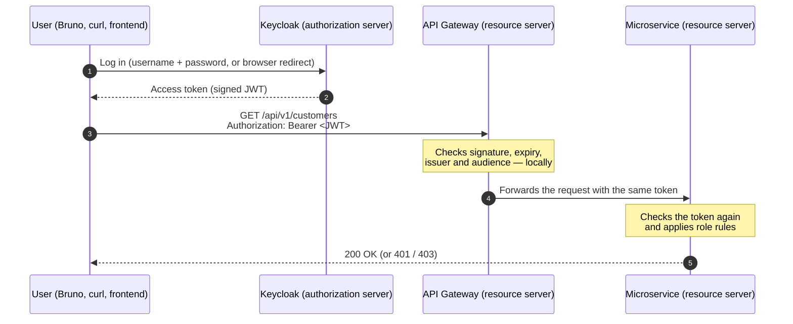

# Security

How users are authenticated and authorized in this project, the concepts behind it, and how each piece is implemented.

> **Status**: Keycloak, JWT validation at the API gateway and in every service, and role-based rules are implemented. Token relay between services (account → onboarding) is in progress.

---

## 1. The big picture



1. The user proves who they are to **Keycloak**, never to the APIs directly.
2. Keycloak returns an **access token**: a signed **JWT** listing who the user is and which roles they have.
3. The user sends this token with every API call, in the `Authorization: Bearer` header.
4. The gateway and the services **verify the token themselves**, without calling Keycloak for each request.

---

## 2. Core concepts

### Authentication vs. authorization

| | Question | Answered by | HTTP error |
|---|---|---|---|
| **Authentication** | *Who are you?* | Keycloak (login), then the token signature | **401 Unauthorized** — no valid token |
| **Authorization** | *Are you allowed to do this?* | The application, from the roles in the token | **403 Forbidden** — valid token, missing role |

### OAuth 2.0 and OpenID Connect

- **OAuth 2.0** is a standard for **delegated authorization**: an application obtains a token that lets it call an API on behalf of a user, without ever handling the user's password itself (except in the development-only password grant).
- **OpenID Connect (OIDC)** is a layer on top of OAuth 2.0 that adds **identity**: who the user is (username, email...).
- These are **standards**. Keycloak is one implementation; Microsoft Entra ID, Okta, Auth0 or AWS Cognito implement the same protocols. The Spring code in this project only relies on the standards: switching provider mostly means changing the issuer URL and where roles are read.

### The four OAuth 2.0 roles

| Role | In this project |
|---|---|
| **Resource owner** | The user (an advisor, a compliance officer...) |
| **Client** | The application asking for a token: Bruno / curl (`bank-cli`), later the frontend (`bank-frontend`) |
| **Authorization server** | Keycloak |
| **Resource server** | The API gateway and the microservices, which accept tokens |

### JWT (JSON Web Token)

A JWT is three Base64URL-encoded parts separated by dots:

```
eyJhbGciOiJSUzI1NiJ9 . eyJpc3MiOiJodHRwOi8v... . SflKxwRJSMeKKF2QT4fw...
       header                  claims (payload)           signature
```

- **Header**: the signing algorithm (`RS256`) and the key id (`kid`).
- **Claims**: the information about the user and the token.
- **Signature**: computed by Keycloak with its **private key**.

**Encoded, not encrypted**: anyone can read a JWT (`./scripts/get-token.sh advisor --decode`), so it must never contain secrets. Nobody can **modify** it without invalidating the signature: the signature guarantees **integrity and origin**, not confidentiality.

Claims used in this project:

| Claim | Meaning | Example |
|---|---|---|
| `iss` | Issuer: who created the token | `http://localhost:8180/realms/bank` |
| `aud` | Audience: who the token is meant for | `bank-api` |
| `exp` | Expiry time (Unix timestamp) | 15 minutes after issue |
| `sub` | Subject: unique id of the user | a UUID |
| `preferred_username` | Login name | `advisor` |
| `realm_access.roles` | Keycloak roles of the user | `["ADVISOR"]` |

### How a resource server validates a token

1. On the first request, download Keycloak's **public keys** from the **JWK Set** endpoint (`.../protocol/openid-connect/certs`) and cache them.
2. For every request, check **locally**:
   - the **signature**, with the public key matching the token's `kid`;
   - **`exp`**: the token has not expired;
   - **`iss`**: it was issued by our realm;
   - **`aud`**: it is meant for `bank-api`, not for another application of the same Keycloak.

Validation is **stateless**: no session, no database, no call to Keycloak per request. This is fast and scales well. The trade-off: a stolen token stays valid until it expires and cannot easily be revoked, hence a **short lifetime** (15 minutes).

### Tokens

| Token | Purpose | Lifetime |
|---|---|---|
| **Access token** | Sent to the APIs to call them | Short (15 min here) |
| **Refresh token** | Sent to Keycloak only, to get a new access token without logging in again | Longer |
| **ID token** (OIDC) | Tells the *client* who logged in; never sent to APIs | Short |

### Grant types (how a client gets a token)

| Grant | Used for | In this project |
|---|---|---|
| **Authorization code + PKCE** | Browser and mobile apps: the user logs in on Keycloak's page, the app receives a one-time code and exchanges it for tokens. PKCE proves that the app exchanging the code is the one that started the login. | `bank-frontend` (planned frontend) |
| **Client credentials** | A service calling another service **on its own behalf**, with no user | Not used yet |
| **Password** (resource owner password credentials) | The client sends the user's username and password itself. **Deprecated** (removed from OAuth 2.1) because the client sees the password. | `bank-cli`, **local development only** |

### Realm, client, roles

- **Realm**: an isolated space in Keycloak with its own users, roles and clients. Ours is `bank`. (`master` is reserved for administering Keycloak itself.)
- **Client**: an application registered in Keycloak that may request tokens. A **public client** (browser, CLI) cannot keep a secret; a **confidential client** (backend) has a client secret.
- **Realm roles**: roles assigned to users, copied into the token under `realm_access.roles`.

### Other terms

- **Bearer token**: "whoever bears (holds) this token is allowed". Sent as `Authorization: Bearer <token>`. Must therefore always travel over HTTPS in production.
- **Stateless**: the server keeps no session between requests; each request carries its own proof.
- **CSRF** (Cross-Site Request Forgery): a malicious site makes the victim's browser send a request to another site, relying on the browser **automatically** attaching that site's cookies. Not applicable here: the token travels in a header the browser never adds automatically, and there is no session cookie — see section 4.
- **XSS** (Cross-Site Scripting): malicious JavaScript injected into a page. If a frontend keeps tokens in JavaScript, XSS can steal them.
- **CORS** (Cross-Origin Resource Sharing): the browser rule that blocks a page from calling another origin unless that origin allows it.

---

## 3. Implementation in this project

### Keycloak

- Runs in Docker Compose with the infrastructure: `http://localhost:8180`, admin console login `admin` / `admin`.
- **Configuration as code**: the `bank` realm is defined in [`infrastructure/docker/keycloak/realm-bank.json`](../infrastructure/docker/keycloak/realm-bank.json) and imported at startup. Keycloak runs in development mode without a database, so recreating the container re-imports the realm from Git.

| Realm element | Value |
|---|---|
| Roles | `ADVISOR`, `COMPLIANCE_OFFICER`, `ADMIN` |
| Users (password = user name) | `advisor` (ADVISOR), `compliance` (COMPLIANCE_OFFICER), `admin` (all three) |
| Client `bank-cli` | Public, password grant — Bruno / curl in development |
| Client `bank-frontend` | Public, authorization code + PKCE (`S256`), redirects to `localhost:4200` and `localhost:5173` |
| Audience mapper | Adds `bank-api` to the `aud` claim of tokens from both clients |
| Access token lifetime | 15 minutes |

**Issuer in Docker.** A token's `iss` normally depends on the URL used to reach Keycloak: `localhost:8180` from the host, `keycloak:8080` from another container. Tokens would then be rejected depending on where they were obtained. `KC_HOSTNAME=http://localhost:8180` makes Keycloak always issue tokens with the public URL. Services running in Docker download the keys from `http://keycloak:8080` (`jwk-set-uri`) but still expect `iss = http://localhost:8180/realms/bank` (`issuer-uri`).

### API gateway

The gateway is an **OAuth 2.0 resource server**: every request without a valid token gets `401`.

- Dependency: `spring-boot-starter-security-oauth2-resource-server`.
- Configuration (`application.yml`):

```yaml
spring:
  security:
    oauth2:
      resourceserver:
        jwt:
          issuer-uri: ${KEYCLOAK_ISSUER_URI:http://localhost:8180/realms/bank}      # expected "iss"
          jwk-set-uri: ${KEYCLOAK_JWK_SET_URI:http://localhost:8180/realms/bank/protocol/openid-connect/certs}  # where to get the public keys
          audiences: bank-api                                                        # expected "aud"
```

- `SecurityConfig`: every request must be authenticated, JWT validation enabled, **stateless** sessions, CSRF disabled.
- The gateway is Spring Cloud Gateway **WebMVC** (servlet), so it uses `HttpSecurity` / `SecurityFilterChain`, not the reactive `ServerHttpSecurity`.
- The `Authorization` header is forwarded unchanged to the services.

### Microservices

Each microservice is also a resource server (defense in depth): calling a service directly, without going through the gateway, still requires a valid token.

- Same dependency and `spring.security.oauth2.resourceserver.jwt` configuration as the gateway, in `application.yml` so that it applies to every profile.
- **Public endpoints**: `/actuator/health/**`, `/actuator/prometheus` (Prometheus scrapes without a token), `/swagger-ui/**`, `/v3/api-docs/**`. Everything else requires authentication.
- Kafka consumers are not affected: Spring Security protects HTTP requests only.

**Mapping Keycloak roles to Spring authorities.** By default Spring builds authorities from the `scope` claim (`SCOPE_email`...). Keycloak puts roles in a *nested* claim, `realm_access.roles`. Each service therefore registers a `KeycloakRoleConverter` that turns every role into an authority prefixed with `ROLE_` (`ADVISOR` → `ROLE_ADVISOR`). The converter is plugged into a `JwtAuthenticationConverter`, which also uses `preferred_username` as the principal name (`advisor` instead of a UUID).

`hasRole('ADVISOR')` checks the authority `ROLE_ADVISOR`; `hasAuthority('ROLE_ADVISOR')` is the explicit equivalent. A role is simply an authority with the `ROLE_` prefix.

**Role rules** are declared on controller methods with `@PreAuthorize` (enabled by `@EnableMethodSecurity`), next to the endpoint they protect. Read endpoints only require an authenticated user.

| Service | Endpoint | Required role |
|---|---|---|
| Onboarding | `POST /customers`, `PUT /customers/{id}` | `ADVISOR` |
| Onboarding | `POST /customers/{id}/block`, `/unblock`, `/close` | `ADMIN` |
| KYC | `POST /kyc-cases`, `PATCH /kyc-cases/{id}/status` | `COMPLIANCE_OFFICER` |
| Document | `POST /documents` (upload) | `ADVISOR` |
| Account | `POST /accounts` | `ADVISOR` |
| Account | `PATCH /accounts/{id}/status` | `ADMIN` |
| All | `GET` endpoints | any authenticated user |

Expected responses: no token → **401**; valid token without the required role → **403**.

### Testing

- **Controller tests** (`@WebMvcTest`) import the real `SecurityConfig`: without it, the slice falls back to Spring Boot's default security (CSRF enabled, different rules) and the tests would not check the actual rules. A mocked `JwtDecoder` satisfies the resource server configuration.
- Requests are authenticated with `spring-security-test`: `.with(jwt().authorities(new SimpleGrantedAuthority("ROLE_ADVISOR")))` injects an already authenticated user, without Keycloak or a real token.
- Each secured endpoint family has **negative tests**: no token → `401`, wrong role → `403`, and `verify(service, never())` proves the request was stopped before reaching business code.
- `jwt().authorities(...)` bypasses the role converter, so `KeycloakRoleConverter` has its own plain unit test (roles present, `realm_access` missing, `roles` missing).

**Order of checks** for a request: security filter (token → `401`) → request body validation (`@Valid` → `400`) → `@PreAuthorize` (role → `403`) → method. Validation runs before the role check: a user without the required role who sends an invalid body gets `400`, not `403`.

### Getting a token

```bash
./scripts/get-token.sh advisor --decode      # show issuer, audience, roles
TOKEN=$(./scripts/get-token.sh advisor)
curl -H "Authorization: Bearer $TOKEN" http://localhost:8088/api/v1/customers
```

See [`scripts/get-token.sh`](../scripts/get-token.sh).

---

## 4. Design decisions and limits

- **Validate tokens in every service, not only at the gateway** (*defense in depth*, *zero trust*): a service reachable directly — by mistake, or from inside the network — must not trust the caller.
- **Role rules on methods (`@PreAuthorize`) rather than URL patterns**: the rule sits next to the endpoint, so it is visible when reading the code and hard to forget when adding an endpoint.
- **The role converter is duplicated in each service** (no shared library, consistent with [ADR-003](adr/ADR-003-event-driven-communication-with-kafka.md)). A shared Spring Boot starter would remove the duplication if more services were added.
- **CSRF protection disabled**: CSRF exploits credentials the browser sends automatically (cookies). Here authentication only uses a bearer token sent explicitly in a header, with no session or cookie. If tokens were ever stored in cookies (BFF pattern), CSRF protection would have to be re-enabled.
- **Short-lived access tokens** (15 min) limit the impact of a leaked token, since JWTs cannot be revoked easily.
- **Coarse roles in Keycloak, fine-grained decisions in the application**: Keycloak says *who* the user is and *which roles* they have; Spring Security decides what each role may do on each endpoint.

**Not production-ready by design** (local demo):

- Keycloak in development mode, without a database, and with HTTP instead of HTTPS (`sslRequired: none`).
- Demo users with trivial passwords and the admin account `admin` / `admin`.
- Password grant enabled for `bank-cli`.
